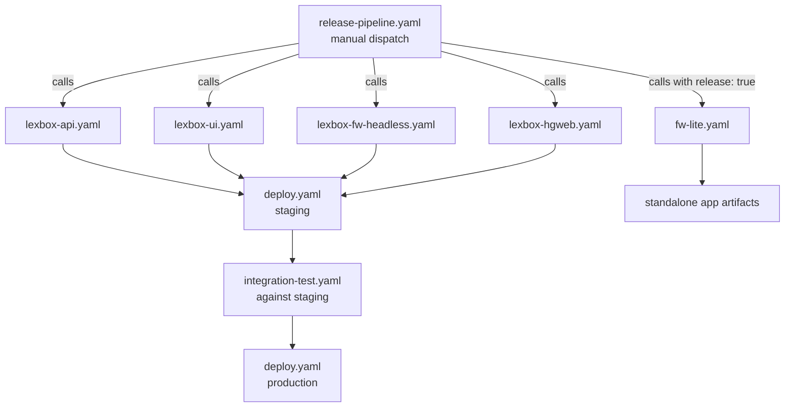

Builds and deployments run on GitHub Actions. Most build workflows are `workflow_call`-only so `release-pipeline.yaml` can compose them; deployment goes through a separate fleet repo. Releases come only from a manual dispatch of the Release pipeline on develop.

The full reference (every workflow, known flaky failures, troubleshooting) is [`.github/AGENTS.md`](https://github.com/sillsdev/languageforge-lexbox/blob/develop/.github/AGENTS.md).

## Workflow dependencies

Integration tests run *after* the staging deploy and gate only production, and even there the pipeline proceeds on a test failure (they're flaky). The real production gate is the GitHub environment approval. `integration-test-gha.yaml` is a different workflow: it spins up Kubernetes inside the runner for develop PRs and pushes, in parallel with the develop deploy, gating nothing.

`fw-lite.yaml` runs on its own for CI. The Release pipeline calls it with `release: true`, which is the only way to publish the GitHub and Play Store release. It does core .NET build and tests on Linux (`FwLiteCore.slnf`), MAUI on Windows, and its own test suite, and it publishes standalone apps for Windows, macOS, Linux and Android instead of Docker images. It never deploys to Kubernetes.

Docker images for the deployed services go to `ghcr.io/sillsdev/` (`lexbox-api`, `lexbox-ui`, `lexbox-fw-headless`, `lexbox-hgweb`), tagged with the branch name, PR number, commit SHA, and `latest` on release builds.

## Environments

| Environment | Domain | When deployed |
|---|---|---|
| develop | develop.lexbox.org | every push to develop |
| staging | staging.languagedepot.org | Release pipeline (manual dispatch from develop) |
| production | lexbox.org, languagedepot.org | same Release run, after staging and integration tests, gated by approval |

Each runs the same set of workloads in its own Kubernetes cluster: the lexbox pod (.NET API plus OTEL collector), Postgres, the hg pod (hgweb and hg-resumable), FwHeadless, and the SvelteKit UI. Non-production environments add an init container that seeds a test repo. Per-environment hostnames are listed in [`deployment/README.md`](https://github.com/sillsdev/languageforge-lexbox/blob/develop/deployment/README.md).

## Fleet repo and GitOps

Nothing in CI talks to a cluster directly. The `lexbox-*.yaml` workflows build the images. `deploy.yaml` renders the manifests with `kubectl kustomize`, copies them into the fleet repo, sets the image tag, and pushes. A `verify-published` job then polls `/api/healthz` until the `lexbox-version` header matches the deployed version. The cluster watches the fleet repo and applies what it finds. That indirection buys an audit trail of every deployment and makes a rollback a revert in the fleet repo.

Kubernetes config lives in `deployment/`: a shared `base/` plus one Kustomize overlay per target (`develop/`, `staging/`, `production/`, `gha/` for integration tests in GitHub Actions, and `local-dev/`). Each overlay includes `base/` and patches in its own settings.

If a deployment doesn't show up: check the deploy job actually ran (production needs approval), that the fleet repo was updated, that the cluster pulled it, and the `https://<domain>/api/healthz` endpoint.
